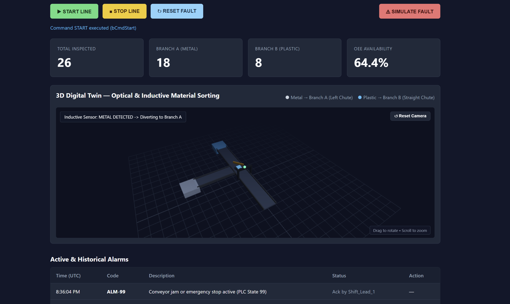
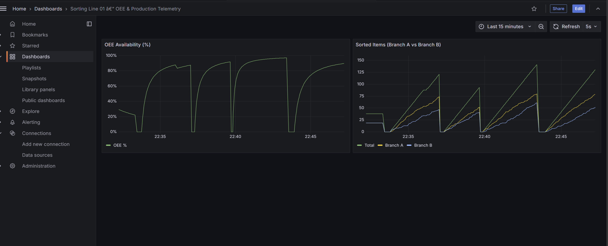

# Virtual Sorting Line — Industrial IoT (IIoT) & Digital Twin Portfolio

[Suomeksi](#-suomeksi) | [In English](#-in-english)

---

## 🇫🇮 Suomeksi

Teollisuusautomaation ja IIoT-arkkitehtuurin kokonaisvaltainen referenssitoteutus, joka yhdistää **IEC 61131-3 -logiikan**, **Zero-Trust OPC UA -tietoturvan**, **reaaliaikaisen telemetrian**, **Web-SCADA / HMI -käyttöliittymän** sekä **Grafana-analytiikan**.

Koko järjestelmä on täysin laitteistoriippumaton: se toimii joko mukana tulevalla Python-pohjaisella virtuaali-PLC:llä (Dockerissa tai lokaalisti) tai suoraan Windowsin **CODESYS Control Win V3** -ajoympäristöä vasten.

### Käyttöliittymä & Analytiikka (Kuvakaappaukset)

**Web-SCADA / HMI & Three.js 3D Digital Twin:**


**Grafana — Reaaliaikainen OEE & tuotantoanalytiikka:**


### Järjestelmäarkkitehtuuri

```text
+-----------------------------------+       +-----------------------------------+
|  Virtual PLC / CODESYS (Port 4841)|       |     Web-SCADA / HMI (Port 8000)   |
|  - IEC 61131-3 State Machine      |<----->|     - FastAPI + Vanilla JS UI     |
|  - Optical Sorting Simulation     | OPCUA |     - Bidirectional PLC Control   |
|  - X.509v3 SignAndEncrypt         |       |     - Alarm Acknowledgment        |
+-----------------------------------+       +-----------------------------------+
                 |                                            |
                 | OPC UA (Basic256Sha256)                    | SQL / REST
                 v                                            v
+-----------------------------------+       +-----------------------------------+
|     Edge Gateway (asyncua)        |------>|      PostgreSQL 16 (Port 5432)    |
|     - Telemetry & OEE Calculation |  SQL  |      - production_metrics         |
|     - Fault Event Detection       |       |      - scada_alarms               |
+-----------------------------------+       +-----------------------------------+
                                                              |
                                                              v
                                            +-----------------------------------+
                                            |     Grafana 11.3 (Port 3000)      |
                                            |     - Auto-Provisioned Dashboard  |
                                            |     - Real-Time OEE & KPIs        |
                                            +-----------------------------------+
Keskeiset ominaisuudet
Kaksisuuntainen OPC UA -ohjaus (Basic256Sha256 + SignAndEncrypt): Kaikki ohjaus- ja telemetrialiikenne on allekirjoitettu ja salattu X.509v3-sertifikaateilla.

Laitteistoriippumaton PLC-simulaattori (plc-simulator/): Emuloi CODESYS Control Win V3:n nimiavaruutta (ns=4), tilakonetta (IDLE, RUN, FAULT) ja lajitteluprosessia.

Web-SCADA / HMI (web-scada/): FastAPI-pohjainen operaattorikäyttöliittymä linjan käynnistykseen, pysäytykseen, vikasimulointiin ja hälytysten kuittaukseen.

Automatisoitu Grafana-analytiikka (grafana/provisioning/): PostgreSQL-tietolähde ja OEE/tuotantograafit latautuvat automaattisesti käynnistyksen yhteydessä.

CI/CD-laadunvalvonta: GitHub Actions ajaa automaattisesti ruff-koodianalyysin ja pytest-yksikkötestit jokaisen muutoksen yhteydessä.

Nopea käynnistys (Docker Compose)
Luo OPC UA -asiakassertifikaatti (jos ei vielä luotu):

Bash
python edge-gateway/generate_certs.py
Käynnistä koko 5 kontin järjestelmä yhdellä komennolla:

Bash
docker compose up -d --build
Avaa käyttöliittymät selaimessa:

Web-SCADA / HMI: http://localhost:8000

Grafana Analytics: http://localhost:3000/d/sorting-line-oee (tunnukset: admin / admin)

Käyttö aidolla CODESYS-logiikalla (valinnainen)
Jos ajat logiikkaa Windowsin CODESYS Control Win V3 -ympäristössä (portti 4840), vaihda ympäristömuuttuja OPCUA_URL=opc.tcp://host.docker.internal:4840 ja tuo client_cert.der CODESYSin luotettujen sertifikaattien listalle (Trusted Certificates).

🇬🇧 In English
An end-to-end Industrial IoT (IIoT) and Digital Twin reference implementation combining IEC 61131-3 PLC logic, Zero-Trust OPC UA security, real-time telemetry ingestion, a bidirectional Web-SCADA / HMI, and auto-provisioned Grafana analytics.

The entire stack is hardware-independent: it runs out of the box using the included Python Virtual PLC simulator (containerized or standalone) or connects directly to a CODESYS Control Win V3 runtime.

System Architecture
Plaintext
+-----------------------------------+       +-----------------------------------+
|  Virtual PLC / CODESYS (Port 4841)|       |     Web-SCADA / HMI (Port 8000)   |
|  - IEC 61131-3 State Machine      |<----->|     - FastAPI + Vanilla JS UI     |
|  - Optical Sorting Simulation     | OPCUA |     - Bidirectional PLC Control   |
|  - X.509v3 SignAndEncrypt         |       |     - Alarm Acknowledgment        |
+-----------------------------------+       +-----------------------------------+
                 |                                            |
                 | OPC UA (Basic256Sha256)                    | SQL / REST
                 v                                            v
+-----------------------------------+       +-----------------------------------+
|     Edge Gateway (asyncua)        |------>|      PostgreSQL 16 (Port 5432)    |
|     - Telemetry & OEE Calculation |  SQL  |      - production_metrics         |
|     - Fault Event Detection       |       |      - scada_alarms               |
+-----------------------------------+       +-----------------------------------+
                                                              |
                                                              v
                                            +-----------------------------------+
                                            |     Grafana 11.3 (Port 3000)      |
                                            |     - Auto-Provisioned Dashboard  |
                                            |     - Real-Time OEE & KPIs        |
                                            +-----------------------------------+
Key Features
Bidirectional Secure OPC UA (Basic256Sha256 + SignAndEncrypt): All telemetry and control commands are signed and encrypted using X.509v3 certificates.

Hardware-Independent PLC Simulator (plc-simulator/): Replicates CODESYS Control Win V3 tag structures (ns=4), state machine (IDLE, RUN, FAULT), and optical sorting physics.

Web-SCADA / HMI (web-scada/): FastAPI operator interface supporting line start/stop, fault injection/reset, real-time KPIs, and operator alarm acknowledgment.

Auto-Provisioned Grafana Analytics (grafana/provisioning/): Pre-configured PostgreSQL datasource and real-time OEE & sorting telemetry dashboard.

Automated CI/CD: GitHub Actions pipeline enforcing ruff linting and pytest unit test coverage across simulator, telemetry processing, and SCADA endpoints.

Quick Start (Docker Compose)
Generate OPC UA client X.509v3 certificates (if not already present):

Bash
python edge-gateway/generate_certs.py
Build and start all 5 containers:

Bash
docker compose up -d --build
Open the web interfaces:

Web-SCADA / HMI: http://localhost:8000

Grafana Analytics: http://localhost:3000/d/sorting-line-oee (default credentials: admin / admin)

Running Against CODESYS Control Win V3 (Optional)
To connect to a live CODESYS runtime on Windows (port 4840), set OPCUA_URL=opc.tcp://host.docker.internal:4840 and move client_cert.der into the CODESYS Trusted Certificates store.

Repository Structure
plc/ — IEC 61131-3 Structured Text (PLC_PRG) and CODESYS project archive

plc-simulator/ — Standalone Python OPC UA PLC simulator (sim_plc.py)

edge-gateway/ — asyncua telemetry bridge, OEE processor, and database schema (init.sql)

web-scada/ — FastAPI backend and operator HMI frontend

grafana/ — Automated Grafana datasource and OEE dashboard provisioning

tests/ — pytest unit test suite